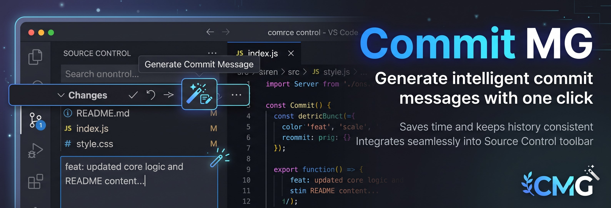

<a href="https://github.com/Abdulla-Aldosari/CommitMG"></a>

# Commit MG

A tiny VS Code extension that adds a single button to the Source Control **Changes** toolbar to generate commit message.



## Workspace Trust

Commit MG runs only in trusted workspaces. In
[Restricted Mode](https://code.visualstudio.com/docs/editing/workspaces/workspace-trust)
VS Code keeps the extension disabled, so the Generate button does not
appear until you trust the folder.

This is deliberate. When a project has a `commitlint.config.js`, Commit MG
reads its scopes, length limits, and scope map from it. That file is
JavaScript, and reading it means running it, so it is only ever done in a
folder you trust (the same trust a commit hook relies on when it runs the
same file). Even then, the file runs in a separate process with a 10 second
time limit, so a broken or slow config cannot freeze or crash the editor.

To use Commit MG in a folder, trust it from the Restricted Mode banner or
with the **Workspaces: Manage Workspace Trust** command.

## Development

```bash
npm install
npm run compile   # or: npm run watch
```

Press `F5` to launch the Extension Development Host and try the extension.
