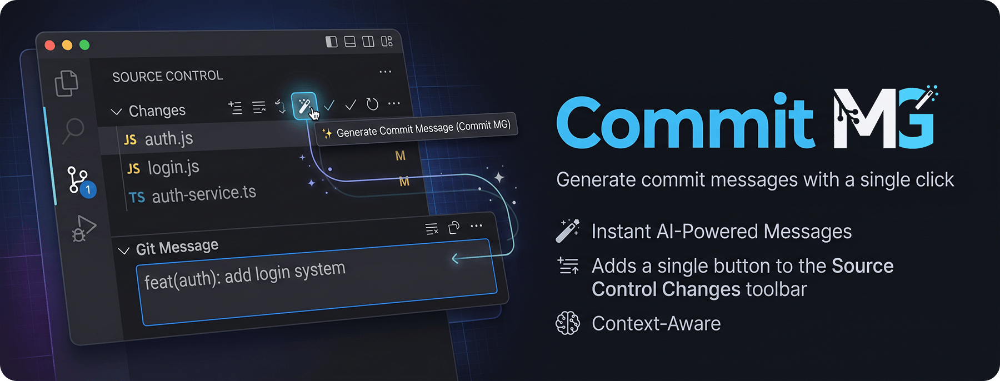

<a href="https://github.com/Abdulla-Aldosari/CommitMG"></a>

# Commit MG

AI-Powered Commit Message Generator for VS Code — that writes a consistent commit message from your changes, following your project's rules, with multiple AI providers and detail levels one click away in the Source Control toolbar.



## How it works

Press the sparkle button in the Source Control toolbar and pick a detail
level: Lengthy, Medium, Short, or Title only. You can set this level to
apply automatically from the settings.

Commit MG first reads your staged changes; if none are staged, it reads
your unstaged changes and new files instead, then sends them to the model
you chose, in line with your project's rules. The generated message is
checked against your project's rules before it is accepted, and if a
violation is found (only when this option is enabled), the generation is
requested again once, with the violations noted so they can be fixed. The
result then appears directly in the commit box.

Any other detail level stays one click away, under **Generate Commit Message
with Another Style** in the Source Control menu.

> [!NOTE]
> A violation is always shown to you in a notification that lists the broken
> rules, such as an unlisted type, a header over the length limit, or a
> wrong scope.

> [!IMPORTANT]
>
> - Picking the right model matters as much as picking the right detail
>   level: a stronger model reads a diff more accurately and is less likely
>   to need a retry, while a weaker or smaller model may miss context or
>   misjudge the scope on a large change. If results feel inconsistent, try
>   a more capable model, or a higher reasoning level, before changing
>   anything else.
> - For the best results, stage one logical change at a time: a focused diff
>   gives the model a clearer picture than a large, unrelated set of changes.
> - If your project uses scopes, map them to file paths in `.commitmgrc.json`
>   or if you use `commitlint.config.js` so the right scope is chosen for you
>   every time, instead of left to the model's guess.
> - Even with validation in place, give the message a quick read before
>   committing, especially if a violation was not corrected automatically.

## Models

Open **Commit MG: Open Settings** and choose one of:

- **A provider's API**: Google Gemini, OpenAI, Anthropic Claude, DeepSeek,
  Groq, Mistral, Cohere, StepFun, or any OpenAI-compatible server (such as
  a local Ollama). The API key is kept in VS Code's secret storage, never
  in your settings files.
- **VS Code's language models** (GitHub Copilot Chat), with no key.

The AI Settings tab can check the connection, show the rate limits a
provider reports, and estimate what each request costs.

## Settings

The settings panel has four tabs:

- **AI Settings**: the provider, the model, and the API key.
- **Speed & Context**: how much of the change the model sees. Fast,
  Balanced, and Thorough set every size at once, and the tab shows how
  large a request is on your current changes. Also the reasoning level,
  temperature, output cap, and request timeout.
- **Message Format**: your own preferences for every repository:
  - the header form: Conventional (`feat(auth): add login`) or Basic
    (`Add login page`, with no type and no scope);
  - a type emoji, chosen from the type: `feat(auth): ✨ add login`;
  - the space between bullet points, the default detail level, and extra
    instructions for the model.

  **View Examples** shows a sample of each detail level.

- **Rules**: the project's rules, which every message follows.

## Project rules

The rules (allowed types, header and body line lengths, whether a header
has a scope, and the list of scopes) come from one place:

1. the project's **commitlint** config, when it has one, so the messages
   pass the same checks commitlint runs at commit time;
2. else **`.commitmgrc.json`** in the repository root;
3. else the built-in rules.

commitlint is not needed. Without it, create `.commitmgrc.json` from the
Rules tab, starting from the Conventional or Angular rules, and edit it
there or by hand. Commit it to share the rules with your team:

```json
{
  "types": ["feat", "fix", "docs", "refactor", "test", "chore"],
  "headerMaxLength": 72,
  "bodyMaxLineLength": 72,
  "scopePolicy": "optional",
  "scopes": [
    { "name": "auth", "description": "login and sessions", "files": ["src/auth/"] },
    { "name": "docs", "description": "documentation", "files": ["docs/"] }
  ]
}
```

A scope with `files` is chosen for you when the changed files fall under
it. Every key is optional, and a file with a mistake is reported in full,
never silently ignored.

## Workspace Trust

Commit MG runs only in trusted workspaces. In
[Restricted Mode](https://code.visualstudio.com/docs/editing/workspaces/workspace-trust)
VS Code keeps the extension disabled, so the Generate button does not
appear until you trust the folder.

This is deliberate. When a project has a commitlint config, Commit MG
reads its rules from it, and a JavaScript config is code: reading it means
running it, so it is only ever done in a folder you trust (the same trust
a commit hook relies on when it runs the same file). Even then, the config
runs in a separate process with a 10 second time limit, so a broken or
slow config cannot freeze or crash the editor. `.commitmgrc.json` is plain
JSON and is never run.

To use Commit MG in a folder, trust it from the Restricted Mode banner or
with the **Workspaces: Manage Workspace Trust** command.

## Development

```bash
npm install
npm run compile   # or: npm run watch
```

Press `F5` to launch the Extension Development Host and try the extension.
