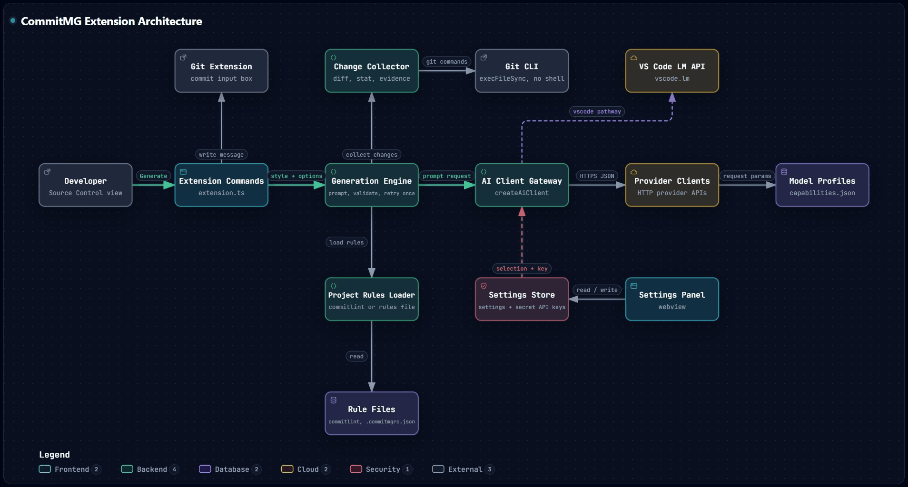

# CommitMG Codebase Map

A navigation guide for anyone (human or automated agent) who has to change this repository. It tells you where each responsibility lives, which rules must never be broken, and which files to touch for common tasks. Every path below is a tracked file or folder in this repository. For depth, follow the links in section 12.

## 1. Quick facts

| Item         | Value                                                                                                                     |
| ------------ | ------------------------------------------------------------------------------------------------------------------------- |
| Product      | VS Code extension that writes a commit message from the repository changes, with a button in the Source Control title bar |
| Package      | `commitmg` v1.0.0, publisher `Abdulla-Aldosari`, MIT                                                                      |
| Host         | VS Code `^1.90.0` (`engines.vscode`); depends on the built-in `vscode.git` extension; activates on `onStartupFinished`    |
| Language     | TypeScript (`strict`, target ES2022, CommonJS) for `src/`; plain browser JavaScript for `media/`                          |
| Entry point  | `src/extension.ts` (`main` points at its bundled output)                                                                  |
| Bundler      | esbuild through `scripts/bundle.js` (two bundles: the extension and the webview logic)                                    |
| Tests        | Mocha + `ts-node/register`, specs in `test/**/*.test.ts`, 10 s timeout (`.mocharc.json`)                                  |
| Runtime deps | None. `gpt-tokenizer` is a dev dependency inlined by the bundler                                                          |

### Commands

| Command                  | What it does                                 |
| ------------------------ | -------------------------------------------- |
| `npm run compile`        | `tsc --noEmit` then `node scripts/bundle.js` |
| `npm run watch`          | `node scripts/bundle.js --watch`             |
| `npm run typecheck`      | `tsc --noEmit`                               |
| `npm run lint`           | `eslint .`                                   |
| `npm test`               | `npm run compile && mocha`                   |
| `npm run prettier:check` | `prettier --check .`                         |
| `npm run package`        | `vsce package`                               |

Definition of done for any change: `npm run typecheck`, `npm run lint`, and `npm test` all pass with zero errors, and `npm run prettier:check` is clean for the files you touched.

## 2. Architecture at a glance

Layering rules (the backbone of the design):

1. `src/generation/` is vscode-free and silent. It never prints, never opens files, and never knows a provider, model, or API key. It receives a ready `AiClient` and calls `complete(systemPrompt, userPrompt, options)`. Failures are thrown.
2. `src/ai/` is vscode-free as well. The one VS Code dependency (the Language Model API) is injected through the `VsCodeLmAccessor` interface; the real implementation lives in `src/settings/vsCodeLmAccessorImpl.ts`.
3. `src/settings/` is the only layer that reads or writes VS Code settings and secret storage, and it owns the settings webview panel.
4. `src/webview/` holds pure, DOM-free logic that is bundled for the browser and also imported by tests. `media/` holds the plain scripts that run inside the webview.
5. Only `src/extension.ts` registers commands and touches the Git extension API.

## 3. Directory map

### `src/extension.ts`

`activate()` / `deactivate()`, command registration, structural types for the Git API, the style QuickPick, progress and error UI, and the prompt preview tab.

### `src/generation/` (commit message engine)

| Path                                              | Responsibility                                                                                            |
| ------------------------------------------------- | --------------------------------------------------------------------------------------------------------- |
| `index.ts`                                        | Public surface of the engine, with a module map in its header comment. Import from here                   |
| `types.ts`                                        | `CommitStyle`, `COMMIT_STYLES`, `NO_CHANGES_ERROR`, limits, default types, scope policies, format types   |
| `options.ts`                                      | Prompt-size options, ranges, defaults, `normalizeOptions`, exclude-pattern validation                     |
| `git.ts`                                          | The only place git runs (`runGit`, `runGitPathList`), via `execFileSync` with an argument array           |
| `changes.ts`                                      | Reads staged, else unstaged and untracked changes; diff splitting, budget sharing, truncation             |
| `evidence.ts`                                     | Old-file evidence for changed files within a character budget                                             |
| `excludedScopes.ts`                               | Scopes the user keeps out of the prompt                                                                   |
| `prepare.ts`                                      | `prepareGeneration`: rules, changes, resolved scopes, evidence, prompts. Shared by generation and preview |
| `prompt/buildPrompt.ts`                           | Assembles the system and user prompts                                                                     |
| `prompt/examples.ts`, `prompt/typeGuide.ts`       | Built-in examples and per-type guidance                                                                   |
| `projectRules/projectRules.ts`                    | Picks exactly one rules source: commitlint config, else the rules file, else defaults                     |
| `projectRules/commitlintLoader.ts`                | Loads `commitlint.config.js` in an isolated process with a timeout                                        |
| `projectRules/commitlintRules.ts`                 | Turns loaded commitlint data into types, scopes, limits, scope policy, scope map                          |
| `projectRules/rulesFile.ts`, `rulesFileSchema.ts` | Reads and validates the rules file (`RULES_FILE`), including limits and bounds                            |
| `projectRules/scopeMap.ts`                        | Maps changed files to scope entries                                                                       |
| `format/typeEmoji.ts`                             | Type-to-emoji table and `applyTypeEmoji`                                                                  |
| `validation.ts`                                   | Deterministic checks of a generated message (header, body, type, scope)                                   |
| `generate.ts`                                     | `generateCommitMessage`: request, validate, at most one correction request; timeout and cancellation      |
| `preview.ts`                                      | `buildPromptForRepo`, `formatPromptPreview`: show prompts without sending anything                        |

### `src/ai/` (provider layer)

| Path                       | Responsibility                                                                                            |
| -------------------------- | --------------------------------------------------------------------------------------------------------- |
| `aiClient.ts`              | The `AiClient` contract and its supporting types (`CompletionOptions`, `CompletionTrace`)                 |
| `aiClientFactory.ts`       | The single gateway: `createAiClient`, `listModelsForProvider`                                             |
| `providersConfig.ts`       | Provider names, base URLs, default models, model filtering                                                |
| `providers/*.ts`           | Transport per provider (URL, headers, fetch). `httpClient.ts` is the shared fetch helper                  |
| `dialects/*.ts`            | Pure request-body building and reply-text extraction per wire format; `dialect.ts` has the shared helpers |
| `params/*`                 | Neutral generation parameters, model profiles, capability store, and the `capabilities.json` data         |
| `vsCodeLmClient.ts`        | `AiClient` over VS Code's Language Model API via `VsCodeLmAccessor`                                       |
| `estimatePromptCost.ts`    | Offline token count and cost estimate with a fixed pricing table                                          |
| `extractAiErrorMessage.ts` | Normalizes provider errors into readable text                                                             |

### `src/settings/` (host side of the settings UI)

| Path                      | Responsibility                                                                             |
| ------------------------- | ------------------------------------------------------------------------------------------ |
| `settingsPanel.ts`        | `SettingsPanel`: creates the webview, CSP and nonce, handles every webview message         |
| `settingsStore.ts`        | Reads and writes VS Code settings and API keys (secret storage); `buildConfiguredAiClient` |
| `userSettings.ts`         | Setting keys, context presets, how a stored snapshot becomes generation options. Pure      |
| `rulesSettings.ts`        | Project-rules data for the Rules tab                                                       |
| `vsCodeLmAccessorImpl.ts` | The real `VsCodeLmAccessor` over `vscode.lm`                                               |
| `externalUrl.ts`          | Validation of URLs the webview may ask to open                                             |

### `src/webview/` and `media/` (settings UI client side)

| Path                                                              | Responsibility                                                                                                                                 |
| ----------------------------------------------------------------- | ---------------------------------------------------------------------------------------------------------------------------------------------- |
| `src/webview/settingsLogic.ts`                                    | Entry of the pure logic bundle, exposed to the browser as `window.CommitMgSettingsLogic`                                                       |
| `src/webview/*.ts`                                                | One pure module per concern: base URL, exclude patterns, format examples, model params, number field, prompt size, rules table, badges, slider |
| `media/settingsMain.js`                                           | Main webview script: state, provider and model UI, message handling                                                                            |
| `media/tabs/*.js`                                                 | One file per tab: `formatTab.js`, `rulesTab.js`, `speedTab.js` (register on `window.CommitMgTabs`)                                             |
| `media/components/*`                                              | Reusable UI components (register on `window.CommitMgComponents`) and `components.css`                                                          |
| `media/customSelect.js`, `icons.js`, `tooltip.js`, `settings.css` | Shared widgets, icons, tooltips, styles                                                                                                        |

### `src/dev/` (developer tools)

| Path                    | Responsibility                                                                                       |
| ----------------------- | ---------------------------------------------------------------------------------------------------- |
| `devSessionRecorder.ts` | Opt-in recorder of generation sessions (`commitmg.developer.enabled`)                                |
| `probe/*.ts`            | Model capability probe: cases, requests, outcome classification, resume, profile derivation, command |

### Other tracked areas

| Path                                           | Responsibility                                                      |
| ---------------------------------------------- | ------------------------------------------------------------------- |
| `test/`                                        | Mocha specs and `test/fixtures/golden/*.txt` prompt snapshots       |
| `scripts/bundle.js`                            | esbuild build script, documented in its header comment              |
| `docs/`                                        | Design documents (section 12)                                       |
| `icons/`                                       | Extension icon (`icon.png`, `icon.svg`)                             |
| `.github/workflows/`, `.github/dependabot.yml` | CI, security audit, CodeQL, dependency updates                      |
| `.husky/`                                      | Git hooks (section 9)                                               |
| `commitlint.config.js`                         | Commit types, scopes, and the scope-to-path map for this repository |
| `cliff.toml`, `CHANGELOG.md`                   | Changelog generation and its output                                 |

## 4. Entry points and contributions (`package.json`)

| Command id                              | Title                                         | Notes                                                                            |
| --------------------------------------- | --------------------------------------------- | -------------------------------------------------------------------------------- |
| `commitmg.insertCommitMessage`          | Generate Commit Message with CommitMG         | `scm/title` navigation button when `scmProvider == git`                          |
| `commitmg.insertCommitMessageWithStyle` | Generate Commit Message with Another Style... | Menu entry shown only when `commitmg.format.defaultDetail` is not `ask`          |
| `commitmg.openSettings`                 | Open Settings                                 | Opens `SettingsPanel`                                                            |
| `commitmg.previewPrompt`                | Preview Prompt (Developer)                    | Shows the prompts in an untitled markdown tab; sends nothing                     |
| `commitmg.probeModelCapabilities`       | Probe Model Capabilities (Developer)          | Code in `src/dev/probe/probeCommand.ts`; enabled by `commitmg.developer.enabled` |

All five commands are registered in `src/extension.ts`.

Configuration keys (declared in `package.json` under `contributes.configuration`):

- AI selection: `commitmg.aiPathway`, `commitmg.aiProviderName`, `commitmg.aiModelId`, `commitmg.aiCustomBaseUrl`, `commitmg.aiOllamaBaseUrl`, `commitmg.aiVsCodeModelId`.
- Speed and context: `commitmg.context.*` (`preset`, `includeEvidence`, `evidenceBudget`, `diffBudget`, `diffContextLines`, `ignoreWhitespace`, `excludePatterns`, and more).
- Message format: `commitmg.format.*` (`emojiPosition`, `convention`, `defaultDetail`, and more).
- Rules: `commitmg.rules.excludedScopes`.
- Developer: `commitmg.developer.enabled`.

API keys are never settings: they live in secret storage (section 7).

## 5. Core flows

### 5.1 Generating a message

1. `src/extension.ts` resolves the repository from the clicked source control (falling back to the first repository), reads the style (button default or QuickPick), and builds the client with `buildConfiguredAiClient` (`src/settings/settingsStore.ts`).
2. `generateCommitMessage` (`src/generation/generate.ts`) calls `prepareGeneration` (`src/generation/prepare.ts`):
   1. `loadProjectRules`: commitlint config, else the rules file, else defaults.
   2. `getChanges`: staged changes, else unstaged and untracked; throws `NO_CHANGES_ERROR` when empty.
   3. `resolveScopesForFiles`, `applyExcludedScopes`, `evidenceForChanges` (only when evidence is enabled).
   4. `buildPrompt`: system and user prompts, with the header limit reduced by the emoji reserve.
3. The client sends the request (`aiClient.complete`) with a per-request timeout (`REQUEST_TIMEOUT_MS`) combined with the caller's abort signal.
4. The reply is validated (`src/generation/validation.ts`). If it breaks the rules and `autoCorrect` is not `false`, exactly one correction request is sent that embeds the previous output and the violation list. There is no second retry.
5. `applyTypeEmoji` adds the emoji in code (the model never writes it); the final header is checked against the real limit.
6. The message goes to the commit input box; violations are reported to the user. A cancelled run throws `GenerationCancelledError` and stays silent.

Progress is reported through `CommitMessageObserver` (stages: `collecting`, `requesting`, `validating`, `correcting`), which is also how the developer recorder sees each step.

### 5.2 Settings round trip

1. `SettingsPanel` (`src/settings/settingsPanel.ts`) renders the HTML with a nonce-based CSP and loads the scripts from `media/` plus the bundled logic script.
2. Scripts in `media/` send messages with `postMessage`; the panel handles each message type in one `switch` (for example `ready`, `selectProvider`, `selectModel`, `saveApiKey`, `checkConnection`, `estimateCost`, `setUserSetting`, `setRulesField`, `createRulesFile`, `openExternalUrl`).
3. The panel writes through `src/settings/settingsStore.ts` and sends the refreshed state back; the webview never receives an API key, only a key-present flag.
4. Pure validation and view logic used by the scripts is in `src/webview/` and reaches the browser as `window.CommitMgSettingsLogic`.

### 5.3 Provider request path

`createAiClient` (`src/ai/aiClientFactory.ts`) selects the client: a provider class in `src/ai/providers/` for direct providers, or `VsCodeLmClient` for the `vscode` pathway. A provider class owns transport only; its dialect in `src/ai/dialects/` builds the body and extracts the text; `src/ai/params/` decides which neutral parameters (reasoning, temperature, output cap) the model accepts.

## 6. Contracts and invariants

Do not break these; tests and the design documents depend on them.

| Invariant                                                                                                                                         | Where it lives                                                    |
| ------------------------------------------------------------------------------------------------------------------------------------------------- | ----------------------------------------------------------------- |
| The engine depends only on `AiClient.complete()`; it never sees a provider, model id, or key                                                      | `src/ai/aiClient.ts`, `src/generation/generate.ts`                |
| All client construction goes through `createAiClient`                                                                                             | `src/ai/aiClientFactory.ts`                                       |
| `src/generation/` and `src/ai/` import nothing from `vscode`                                                                                      | whole folders                                                     |
| Every git call goes through `runGit` / `runGitPathList` (no shell, argument array; repository file names are untrusted)                           | `src/generation/git.ts`                                           |
| Prompt preview and generation share `prepareGeneration`, so the preview always shows what generation would send                                   | `src/generation/prepare.ts`                                       |
| Exactly one rules source is active per run (commitlint, else rules file, else defaults); they are never mixed                                     | `src/generation/projectRules/projectRules.ts`                     |
| At most one correction request per generation                                                                                                     | `src/generation/generate.ts`                                      |
| The type emoji is added by code after the model replied; the model limit is shrunk by the emoji reserve                                           | `src/generation/prepare.ts`, `src/generation/format/typeEmoji.ts` |
| A reply cut off at the output limit is rejected even when it holds text                                                                           | `src/ai/dialects/dialect.ts`                                      |
| Model-parameter decisions ("may this model take this value") live in the profile layer; dialects only translate                                   | `src/ai/params/modelProfile.ts`, `src/ai/dialects/`               |
| The webview never receives an API key, only a key-present flag per provider                                                                       | `src/settings/settingsPanel.ts`, `docs/security.md`               |
| Webview pure logic stays DOM-free and vscode-free so Mocha can test it                                                                            | `src/webview/`                                                    |
| Golden prompt snapshots lock the exact prompt text; an intentional prompt change is recorded with `UPDATE_GOLDEN=1` and the fixture diff reviewed | `test/goldenPrompts.test.ts`, `test/fixtures/golden/`             |

## 7. Secrets and security surface

- API keys are stored with `context.secrets` (key pattern `commitmg.apiKey.<provider>`), never in settings files. Access functions: `readApiKey`, `writeApiKey`, `deleteApiKey`, `readAllKeyStatuses` in `src/settings/settingsStore.ts`.
- The webview runs with `default-src 'none'`, a nonce for scripts, and `localResourceRoots` limited to the `media/` folder and the bundled webview logic folder (`src/settings/settingsPanel.ts`).
- URLs requested by the webview are validated in `src/settings/externalUrl.ts` before opening.
- A commitlint config is executed in an isolated process with a timeout (`COMMITLINT_LOAD_TIMEOUT_MS`).
- Full model and threat list: `docs/security.md`.

## 8. Task playbooks

Where to edit for common tasks. Always add or update the matching test (section 10).

| Task                              | Touch these                                                                                                                                                                                                                                                                                                                                    |
| --------------------------------- | ---------------------------------------------------------------------------------------------------------------------------------------------------------------------------------------------------------------------------------------------------------------------------------------------------------------------------------------------- |
| Add a fixed AI provider           | `src/ai/providersConfig.ts` (name type, config, base URL); a client in `src/ai/providers/` and a dialect in `src/ai/dialects/` when the wire format is new; the `switch` in `src/ai/aiClientFactory.ts`; the `commitmg.aiProviderName` enum in `package.json`; `src/ai/params/capabilities.json`; tests. Details: `docs/ai-provider-system.md` |
| Add or change a model capability  | `src/ai/params/capabilities.json` (data); `src/ai/params/capabilityStore.ts` and `modelProfile.ts` (logic). The probe in `src/dev/probe/` can derive profiles                                                                                                                                                                                  |
| Change the prompt text            | `src/generation/prompt/` (`buildPrompt.ts`, `typeGuide.ts`, `examples.ts`); then run the golden test and update fixtures deliberately. Details: `docs/prompt-design.md`                                                                                                                                                                        |
| Add a validation rule             | `src/generation/validation.ts`; its violations feed the correction prompt in `src/generation/generate.ts`                                                                                                                                                                                                                                      |
| Change project-rule loading       | `src/generation/projectRules/*`; the Rules tab view is `src/settings/rulesSettings.ts`, `src/webview/rulesSource.ts`, `src/webview/rulesTable.ts`, `media/tabs/rulesTab.js`                                                                                                                                                                    |
| Add a user setting                | `package.json` (`contributes.configuration`), `src/settings/userSettings.ts` (key, validation, mapping), `src/settings/settingsStore.ts`, the tab in `media/tabs/`, and `docs/settings.md`                                                                                                                                                     |
| Add a webview message             | Handler in `src/settings/settingsPanel.ts`, sender in the relevant `media/` script, pure logic in `src/webview/` (exported from `settingsLogic.ts`)                                                                                                                                                                                            |
| Add a webview UI component        | `media/components/` (register on `window.CommitMgComponents`), styles in `media/components/components.css`, and the script list in `src/settings/settingsPanel.ts`                                                                                                                                                                             |
| Add a command                     | `package.json` (`contributes.commands` and menus), `registerCommand` in `src/extension.ts`                                                                                                                                                                                                                                                     |
| Change what context a prompt gets | `src/generation/changes.ts`, `evidence.ts`, `options.ts` (ranges and defaults), and the matching settings                                                                                                                                                                                                                                      |
| Change the build or packaging     | `scripts/bundle.js` (read its header comment first) and `.vscodeignore`                                                                                                                                                                                                                                                                        |

## 9. Build, CI, and hooks

- **Bundles** (`scripts/bundle.js`): the extension bundle (Node, CommonJS, target node20, only `vscode` external) and the webview logic bundle (browser IIFE, global `CommitMgSettingsLogic`). The script wipes its output folder first, so never put hand-written files there.
- **Packaging**: `.vscodeignore` keeps sources, tests, scripts, and `docs/*.md` out of the package.
- **Git hooks** (`.husky/`):
  - `pre-commit`: `lint-staged` (Prettier on `*.{js,ts,json,css,md}`), `npm run lint`, and an index-stat refresh step.
  - `commit-msg`: commitlint on the message.
  - `pre-push`: `npm run typecheck` and `npm test`.
- **Workflows** (`.github/workflows/`): `ci.yml` (compile and `vsce package --no-dependencies`), `test.yml` (`npm test`), `lint.yml` (typecheck and ESLint), `audit.yml` (`npm audit --audit-level=high`, weekly and on push), `codeql.yml`. They use Node 20.
- **Dependencies**: `.github/dependabot.yml` opens weekly npm update PRs with the `chore` prefix and the `deps` label.
- **Changelog**: generated from commit history with `git-cliff` (`cliff.toml`) into `CHANGELOG.md`, so commit messages must follow the rules in `commitlint.config.js`.
- **Debugging**: `.vscode/launch.json` has a "Run Extension" configuration; `.vscode/tasks.json` runs `npm run compile` as the default build task.

## 10. Testing map

Run one spec with `npx mocha test/<name>.test.ts`; run all with `npm test`. Specs import from `src/` directly. Each name below is a file `test/<name>.test.ts`.

| Area                  | Specs                                                                                                                                                                                                                                            |
| --------------------- | ------------------------------------------------------------------------------------------------------------------------------------------------------------------------------------------------------------------------------------------------ |
| Prompt and generation | `generation`, `goldenPrompts`, `basicConvention`, `additionalInstructions`, `generationOptions`, `generationRunControl`, `cancellation`, `diffBudget`, `typeGuide`, `typeEmoji`, `messageFormat`                                                 |
| Git and project rules | `gitSafety`, `commitlintLoader`, `rulesFile`, `excludedScopes`, `excludedScopesRepo`                                                                                                                                                             |
| Providers and params  | `providersConfig`, `providerBodies`, `httpClient`, `geminiClient`, `ollamaClient`, `modelFiltering`, `modelProfiles`, `capabilityStore`, `extractAiErrorMessage`, `estimatePromptCost`                                                           |
| Developer probe       | `probeCases`, `probeResult`, `probeResume`, `probeRunner`, `profileFromOutcomes`, `ollamaModelInfo`                                                                                                                                              |
| Settings and webview  | `userSettings`, `rulesSettings`, `externalUrl`, `webviewBaseUrl`, `webviewExcludePatterns`, `webviewFormatExamples`, `webviewModelParams`, `webviewNumberField`, `webviewPromptSize`, `webviewRules`, `webviewSettingBadge`, `webviewStepSlider` |

Golden prompt fixtures are in `test/fixtures/golden/*.txt`. After an intentional prompt change, run the suite with the environment variable `UPDATE_GOLDEN=1` (set it with your shell's syntax) and review the fixture diff before committing.

## 11. Conventions and pitfalls

Conventions:

- All text inside repository files is English. Strings are built with template literals, never the `+` operator.
- Header comments at the top of a module explain its purpose; keep them accurate when you change behavior.
- New non-trivial logic gets a small Mocha test. Prettier formatting is enforced by the pre-commit hook.
- When you add, delete, or rename a tracked file or folder, check the `baseScopes` list in `commitlint.config.js`: a directory scope ending in `/` already covers new files inside it; a new top-level path needs a scope entry; the `release` scope must remain.
- Commit messages must satisfy `commitlint.config.js` (types and scopes); the changelog is generated from them.

Pitfalls:

- `src/generation/` throws instead of printing; user-facing messages are produced in `src/extension.ts`.
- A commitlint config in an unreadable format (TypeScript, YAML) makes the defaults apply and the rules file ignored; the Rules tab says why.
- Header limits shrink by the emoji reserve when emoji is on; compare against `modelLimits` for the model text and `limits` for the final message.
- Build output is rebuilt from scratch on every build; never edit it by hand.
- The estimate-cost pricing table has a verified-date constant (`PRICING_RETRIEVED_AT` in `src/ai/estimatePromptCost.ts`) and a staleness test; update both together.
- Provider capability data is JSON bundled at build time; edit `src/ai/params/capabilities.json`.

## 12. Related documents

| Document                     | Read it when                                                                                                       |
| ---------------------------- | ------------------------------------------------------------------------------------------------------------------ |
| `docs/ai-provider-system.md` | You touch providers, the client factory, dialects, the VS Code LM pathway, or the settings host side               |
| `docs/prompt-design.md`      | You change prompt structure, teaching systems, validation layers, commitlint integration, or numeric settings      |
| `docs/settings.md`           | You add or change a setting or a settings tab                                                                      |
| `docs/security.md`           | You change anything that crosses a trust boundary: git output, secrets, webview, commitlint loading, model replies |
| `README.md`                  | You need the user-facing behavior                                                                                  |
